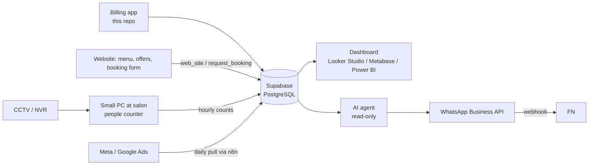

# Habibs Fuljhore — one database for everything

## Decision

Use **one Supabase project (PostgreSQL, Mumbai region)** as the single database for every technical system the salon runs: billing (this app), bookings, WhatsApp, CCTV footfall, marketing, and later the AI agent.

Why PostgreSQL on Supabase:

- **Works with everything.** Every dashboard tool (Power BI, Looker Studio, Metabase), every automation tool (n8n, Make, Zapier), Python and Databricks can connect to Postgres. Supabase adds a REST API, logins, file storage, scheduled jobs and small server functions, so you don't need to run a server.
- **Agent-ready.** AI agents can query it with SQL. Supabase has an official MCP server that can be run read-only. The `v_*` views in `01_schema.sql` give the agent clean tables to start from.
- **Cheap.** The free plan is enough for years of salon data (a busy year of bills stays well under 100 MB of the 500 MB limit). Pro is US$25/month when you want daily backups and no pausing.
- **Not locked in.** It is plain Postgres. `pg_dump` moves it to Azure PostgreSQL, AWS or a local server at any time.

## The whole system

**Rule 1: every source writes its own tables in the same database.** Nothing copies data between systems.
**Rule 2: the customer's mobile number joins everything.** Bills, bookings and WhatsApp chats all carry `phone` (10 digits, no +91), so one query can follow a person from ad → WhatsApp → booking → visit → repeat visit.
**Rule 3: raw stays raw, views do the thinking.** Tables store events as they happened. Dashboards and the agent read `v_*` views.

## Tables

Already built (billing app and website): `customers`, `bills`, `bill_items`, `service_categories`, `services`, `service_changes`, `offers`, `bookings`, `booking_items`, `staff`, `attendance`, `staff_advances`, `payslips`, `products`, `stock_moves`, `service_usage`, `settings`. Diagrams and who may do what: `docs/DATA-MODEL.md`.

The website reads the menu, offers and salon details through `web_site()` and sends booking requests through `request_booking()` (bookings: phone, services, day, source, status requested / confirmed / came / no-show / cancelled, `utm` campaign, bill_id). See `docs/WEBSITE.md`.

To add for the Customer Intelligence System (same database, same rules):

| Table | Written by | Key columns |
|---|---|---|
| `whatsapp_messages` | WhatsApp Business API webhook | phone, direction (in/out), template, campaign_id, sent_at, read_at, replied |
| `campaigns` | You / n8n | name, channel, start, end, spend, offer_code |
| `ad_daily` | n8n pulling Meta and Google Ads | day, campaign, spend, impressions, clicks, leads |
| `footfall_hourly` | Edge PC counting people from CCTV | hour_at, entries, exits, avg_wait_min |

## The questions this answers

| Question | From |
|---|---|
| Visitor frequency, new vs returning, retention | `bills.is_new_customer`, `customers.visits`, `first_visit`, `last_visit` |
| Peak hours, staffing per hour | `v_hourly_traffic` (bills) + `footfall_hourly` (people), next to `attendance` |
| Walk-ins who left without a bill | `footfall_hourly.entries` − bills in that hour |
| Services and spend | `v_sales_lines` |
| Who is due for a visit | `customers.last_visit` older than their usual gap |
| Which campaign brought paying customers | `campaigns` / `ad_daily` → `bookings.source` / `customers.source` → `bills` |
| Staff productivity | `v_sales_lines` by `staff_id`, with `attendance` |

## CCTV: counts only

Run a person-counting model (for example YOLO with a line-crossing counter) on a small PC at the salon that reads the NVR's RTSP stream. Send only **numbers** to the database (entries and exits per hour). Do not store faces or video in the database.

Recognising returning customers by face is personal data processing under India's DPDP Act and needs clear consent. The mobile number at billing already tells you who returned, without that risk.

## Privacy basics (DPDP Act)

- WhatsApp offers go only to customers with `whatsapp_ok = true` (asked at their first bill).
- Keep the anon key public and the service key secret. Logins only for staff, sign-ups turned off.
- Give the AI agent a **read-only** database role. It should draft WhatsApp messages for a person to approve, not send them on its own.

## Build order

1. **Now:** billing app live, daily backups on.
2. **Month 1–2:** website reads the menu from the database and sends bookings (tables and functions are ready, see `docs/WEBSITE.md`); a bookings screen in the app. Simple dashboard in Looker Studio (free) on the views.
3. **Month 2–3:** WhatsApp Business API webhook → `whatsapp_messages`; "due for a visit" reminders.
4. **Month 3+:** CCTV counter on a small PC → `footfall_hourly`; AI agent with read-only access writing a weekly insights summary.
