# Data model: one database for the billing app and the website

Everything lives in one Supabase (PostgreSQL) database. The billing app writes and reads it with a staff login. The website reads it with **no login**, through three functions only. Nothing is copied between systems, so a price changed at the counter is the price on the website at its next page load.

All of it is in `supabase/01_schema.sql` (safe to run again) and `supabase/02_seed_services.sql` (the rate chart: fills a new database, upgrades the October menu, safe to run again).

## Rules the model follows

1. **One fact, one place.** A service's price lives only in `services`. The website, the billing screen, offers and bookings all read that row.
2. **Ids never change; names can.** Every table uses a `uuid` primary key. The website also gets a readable `slug` (`hair-spa`, `global-colour-women`) that is set once and never changes, so links and bookings keep working when you rename something.
3. **Bills keep a copy.** A bill line stores the name, category and price as billed. Renaming or repricing a service later never changes an old bill (GST records stay true).
4. **The mobile number joins people.** `customers.phone` (10 digits, no +91) joins bills, bookings, and later WhatsApp and campaigns.
5. **Every change is a row.** Stock changes are `stock_moves`; menu changes are `service_changes`; owner approvals are `owner_grants`. Nothing important is overwritten without a trace.
6. **The database enforces the rules, not the screens.** Row level security is on for every table. The website's public key can't read or write any table at all.

## Menu, offers and bookings (shared by the app and the website)

| Table | What it is | Written by | Read by |
|---|---|---|---|
| `service_categories` | One menu group: "Hair Spa", "Waxing". Holds the billing tab (`section`) and the website fields: page, tab, type filter, description, small print, picture, "Book consultation", show on website. | Owner (Settings → Services & prices) | App, website |
| `services` | One menu line: name on the bill, price, options (S/M/L…), an optional second choice added to the price (`extra_options`, e.g. hair thickness: Thick +₹500), GST, and the website fields: website name, one line under the name, what's included, minutes, for whom, show on website, online booking. | Owner | App, website |
| `service_changes` | Every add or change to a service or category: field, before, after, who saved it, who approved it. | Database (trigger) | Owner |
| `offers` | Festival, weekday and happy-hour offers. The app applies them at billing; the website shows those marked "show on website". | Owner | App, website |
| `bookings` | A booking request: name, phone, day, time, source (website, WhatsApp, phone), status (requested → confirmed → came / no-show / cancelled), campaign (`utm`), and the bill when they came. | Website (`request_booking`), counter | Counter, owner |
| `booking_items` | The services in a booking, with the menu price at the time. | Website, counter | Counter, owner |
| `enquiries` | Someone asked (a price, a service, a day) but hasn't booked: from WhatsApp, a call, Instagram, or the website's "Ask us" form. Status new → replied / follow up → booked / came / closed (with the reason). | Website (`request_enquiry`), counter | Counter, owner |

**The visit link.** A paid bill for a phone that has a booking that day marks the booking **came** and links the bill; that phone's open enquiries from the last 30 days are marked **came** too. A cancelled bill puts the booking back to confirmed. A database trigger on `bills` does it (`link_visit`), so billing has no extra step. Counter bookings go through `save_booking()` (prices from the menu, a time makes it confirmed); the same rules are in `src/lib/localdb.js` for the demo.

`services.section` and `services.category` are copies of the category's section and name. Offers and reports match on the name, and the database keeps the copies right by itself: renaming a category renames it on its services and in every offer that uses it.

## Billing, staff and stock (the app only)

| Table | What it is |
|---|---|
| `customers` | One row per mobile number. Visits, spend, first and last visit and the loyalty `points` balance are kept up to date by the database (nobody can type a balance). |
| `loyalty_points` | Every change to a customer's points: earned and used on a bill, given back or taken off when a bill is cancelled, expired after 12 months without a visit. The balance is their sum. Written only by `create_bill`, `cancel_bill` and `expire_points`; any approved login reads them. |
| `bills`, `bill_items` | `bills.paid_points` (₹ paid with points, a payment like cash), `points_earned`, `points_balance` (after the bill, for reprints). `bill_items.line_discount`: a discount the counter gave on that one line (part of its `discount`, after the offer). `bill_items.staff_discount`: the staff price on a staff member's own service (free or 50% off; part of `line_discount`), and `commission_base`: the line's value before it, which payroll uses for the commission of whoever did the service. `bills.for_staff`: the staff member whose number the bill is on (`staff_price_check()` checks the prices). `wa_messages`: each bill sent on WhatsApp (WhatsApp Business Platform): the number, sending / sent / delivered / read / failed and why, WhatsApp's message id; written only by the `whatsapp` Edge Function (service key), read by the app. Past bills (owner only, `create_bill` with `past`) are numbered HF2627-P0001 in their own series and dated as typed; `owner_here()` (owner login or the owner's code at the counter) allows them, and adding services and categories. Read-only once saved. Written only by `create_bill` (which checks every figure to the paisa, and every price and offer against the menu) and `cancel_bill`. |
| `bill_payments` | How each bill was paid, one row per way of paying (cash, upi, card, points), kept by a trigger on `bills` from its paid columns. A wallet, gift voucher or package later is a new `mode` here, not a new column. Read-only for the app. |
| `counters` | Bill numbers per financial year. |
| `staff`, `attendance`, `staff_advances`, `payslips` | People, attendance days (P, H, A, W, L), advances, salary slips (with week offs, leave, days off not taken, unpaid days off and the day rate). See *Staff* below. |
| `products` | Retail and salon-use products: MRP, supplier discount, cost, selling price, size, how many services one lasts (`uses_per_unit`, optional), note, "finished" (on the To buy list). Stock is kept by `stock_moves`. |
| `stock_moves` | Every stock change: in, taken out (who, empty back or not), sold, corrected, returned. The only way `products.stock` changes. Each take-out ("Give out") is one unit: a bottle, tube, jar or kit in use. `unit_size` keeps a pack size other than the usual one (a 500 ml delivery of a 1 L product), at Stock in and Give out. |
| `service_usage` | Which services use a product ("Used in"), and how much one counts as (`weight`, 1 = a normal service). |
| `unit_ends` | When a unit was used up: the empty handed back at the next Give out, finished without the empty, "One is empty", or the product marked Finished. Written only by `issue_stock`, `end_unit`, `mark_finished`. |
| `free_uses` | A service done without a bill (redo, staff's own, family, training), so its product use is counted. Written only by `record_free_use`; only the owner reads it. |
| `unit_checks` | At the weekly count, how much was left in the one in use, and what the bills showed then ("running fast"). Owner only. |
| `alerts_sent` | Telegram stock alerts already sent, so each goes once. |
| `expenses` | Money paid out for anything but stock and salaries: day, amount, what for, paid from (cash drawer, UPI, bank, owner), note, who added it. Added only through `add_expense()`; only the owner removes one (`cancel_expense()`), and it stays, marked cancelled. |
| `cash_closes` | One row per day closed: what was left before, cash from bills, cancelled cash bills, drawer expenses, what should be there, what was counted (and the notes), the difference, taken out, left for tomorrow, the day's sales by way of paying. `cash_now()` gives the live figures; `close_day()` works them out again in the database and saves them. A close covers everything since the close before it, by time. Nobody can edit one; the owner can count the day again. |
| `wa_messages` | Every WhatsApp message the app sent: bills, salary slips (`kind` slip, `payslip_id`; to the staff member's own number, sent only for an owner's login), and the automatic ones (`kind` feedback, reminder, winback) with the bill, booking or customer they are for. `dedupe` is unique, so each goes once. `wa_due()` (the whatsapp function only) lists who is due now; the same rules are in `src/lib/waAuto.js`. |
| `feedback` | What a customer answered to "How was your visit?" (good, ok, bad), one per bill, what they wrote after, and when the owner dealt with it (`handle_feedback()`). Written by the whatsapp function. `customers.wa_stop`: replied STOP, no automatic messages. |

**Bottle check.** The database counts how many services each unit lasted: the paid service lines of the services ticked for that product, while it was in use (a service done while two were open counts half for each), with hair length and thickness from the bill line's option ("(L · Thick)" = 2.5). `unit_report()` returns it for the app; `product_units()` does the counting. The same maths is in `src/lib/units.js` for the demo, and `npm test` checks the two agree on random data. Billing is unchanged: nothing extra is typed at the counter.

## Staff: face check-in, leave, documents

| Table | What it is |
|---|---|
| `staff_faces` | One face print per person (1–10 looks of 128 numbers), a small photo from set-up, and when they agreed. Owner writes; any approved login reads (the tablet matches faces). |
| `check_ins` | One a day per person: in and out time, a small photo of each, and how close the face was. Written only by `face_check_in()`, which also marks the day present. The counter reads them; only the owner can delete one. |
| `attendance` | One row per person per day: P present, H half day, A absent, W week off, L leave, with who marked it (face check-in, leave approved, the owner). Owner writes; face check-in and approved leave write through the database. No row = present. |
| `leave_requests` | Leave asked at the counter (`request_leave()`, which applies the owner's rules through `leave_rule_error()`: no Friday–Sunday, one person a day, the last week asked 14 days before; medical leave exempt): days, kind, reason, waiting / approved / refused / cancelled, who answered. Approving makes the days L in attendance (trigger `leave_to_attendance`); cancelling takes them off. Only the owner answers (`decide_leave()`, or Telegram through the service key); the counter can only cancel a request that is still waiting. |
| `staff_documents` | Aadhaar (last 4 digits only), PAN, photo, bank, address proof, certificate, agreement: the number and a file in the private storage bucket `staff-docs`. Owner only, the files too. |

`day_summary()` gives the morning Telegram message (leave today and tomorrow, leave waiting, today's bookings, who didn't check in yesterday) once a day, to the Telegram function only. Paid days off: setting `paid_offs_per_month` (4); day rate = salary ÷ (days in the month − 4), salary = day rate × days worked, so days off not taken are paid and days above 4 are not (`calcPayroll()`). Leave rules: settings `leave_blocked_days` ([5, 6, 0]), `leave_one_at_a_time` (true), `leave_notice_days` (14). Staff's own services: `staff_free_sections` (["Hair", "Threading", "Waxing"]), `staff_discount_pct` (50). Planning before leave: `leave_plan(id)` (the days, the bookings given to them then, who else is off, how many are in) and `leave_plan_due(id)` (once each, 7, 3 and 1 days before: setting `leave_alert_days`); `day_summary()` carries them as `leave_ahead`, and on Mondays `week_leave`. WhatsApp bills: setting `wa_bills_on` (false).

Logins and approvals: `app_roles` (who is an owner), `login_requests` (each staff sign-in waits for approval), `owner_grants` (each owner approval: unlock, cancel, discount, stock, service change), `owner_secrets` (the Authenticator key, never readable by the app).

## Who may do what

| | Counter login | Owner login | Website (no login) |
|---|---|---|---|
| Read the menu, offers, settings | Yes | Yes | Only through `web_site()` |
| Change a service or category | Only with the owner's OK for **that exact change** (Telegram), or while the owner's Authenticator code is unlocked at the counter | Yes | No |
| Change offers, settings, staff, product prices | With an owner unlock | Yes | No |
| Bills | Make (`create_bill`); cancel only with approval | Yes | No |
| Bookings | Read, add, update | Yes | Add only, through `request_booking()` |
| Customers | Read and update (not the points balance) | Yes (not the points balance) | No |
| Loyalty points | Read; use them on a bill (`create_bill` checks the balance, 100 minimum, 20% of the bill) | Same | No |
| Attendance | Read; check staff in with their face (`face_check_in`) | Yes (marks by hand) | No |
| Face prints | Read (to match on the tablet) | Set up, remove | No |
| Leave | Read, ask (`request_leave`), cancel a waiting request | Approve, refuse, cancel | No |
| Staff documents | No | Yes | No |

Why service changes always ask: the website shows the same prices, so you see every change. A general "open owner screens" approval on Telegram is not enough for them.

## The website's functions

- `web_site()` returns the whole public menu in one call: categories (in the shape of the website's `CATALOGUE`), their visible services with prices and options, live and coming offers, and salon details (address, phone, hours). No costs, stock, customers, staff or bills. It also returns a `version` that changes whenever the menu, offers or settings change, so the website can keep a copy until then.
- `request_enquiry(p)` takes a question from the website's "Ask us" form (name, phone, the question, the services it's about), with the same spam limits.
- `request_booking(p)` takes a booking request. It checks the phone, name, date (today to 90 days ahead) and services, takes every price from the menu (never from the website), links an existing customer by phone, and limits spam (3 a day per number, 5 an hour per connection, 30 an hour in total).

How to connect the website: `docs/WEBSITE.md`.

## Planned tables (same database, same rules)

For the Customer Intelligence System. They join on `phone`, `bookings.utm` and dates.

| Table | Written by | Joins |
|---|---|---|
| `whatsapp_messages` | WhatsApp Business API webhook | `phone` → customers, bookings |
| `campaigns`, `ad_daily` | You / n8n pulling Meta and Google Ads | `campaign` ↔ `bookings.utm.campaign`, `customers.source` |
| `footfall_hourly` | Small PC at the salon counting people on CCTV | hour ↔ bills and bookings per hour |

## Adding features later without reshaping the model

The model is built so new features are **added** (a table, a column, a setting), not reshaped:

| Later feature | What it needs | Changes to what exists |
|---|---|---|
| Prepaid wallet, gift vouchers, packages, memberships | New tables (`credits`, `credit_moves`), a new `mode` in `bill_payments` | None: bills already take any payment row; points work the same way today (`loyalty_points`) |
| More automatic WhatsApp messages (birthday, due for a colour touch-up) | A new `kind` in `wa_messages`, a rule in `wa_due()` and a template | None |
| Client notes, colour formula, photos | New table on `customer_id`; files in private storage like `staff-docs` | None |
| Incentive slabs, shift roster | New tables on `staff_id`; `bill_items.commission_base` is already the base | None |
| A new rule or switch | A row in `settings` (key and value) | None |
| A new billing tab, service option or extra choice | A value in `menu_sections()`; options are JSON on `services` | None |
| A second branch | A `branches` table and a `branch_id` column (default: this salon) on bills, bookings, staff, stock moves, counters | Columns added with a default, so old rows stay valid. This is the one feature that touches many tables; do it when the second outlet is real |
| Customer Intelligence (campaigns, footfall) | The planned tables below, joined on `phone`, `bookings.utm` and dates | None |

What keeps it stable: every table has a `uuid` key that never changes; bills copy names and prices, so menu changes never touch history; money moves are rows (`stock_moves`, `loyalty_points`, `bill_payments`), never overwritten numbers; rules live in `settings`; and `01_schema.sql` only ever adds (`if not exists`), with a test that upgrades the October 2026 database on every run.

## Changing the schema later

- Add columns with `add column if not exists`, new tables with `create table if not exists`, and run the whole `01_schema.sql` again. `npm test` runs it twice on a new database and once on a copy of the October 2026 schema (`tests/fixtures/`) to make sure an upgrade keeps every bill, customer and service.
- `02_seed_services.sql` is safe to run again: services are matched by name (or their October name), kept with the same id and set to the chart; the chart's categories not on it are hidden. Nails and Makeup & Bridal are only added when missing.
- `service_categories.section` is the billing tab: one of `menu_sections()` (Hair, Colour, Hair Spa, Hair Treatments, Facials, D-Tan, Threading, Waxing, Nails, Beauty, Makeup). A category without a website page goes on `section_web_page(section)`.
- The website fields per category come from `MENU` in `src/data/menu.js` (written by `02_seed_services.sql`). The October upgrade block in `01_schema.sql` keeps the October list for databases made before November; a test checks it against the 6 November menu.
